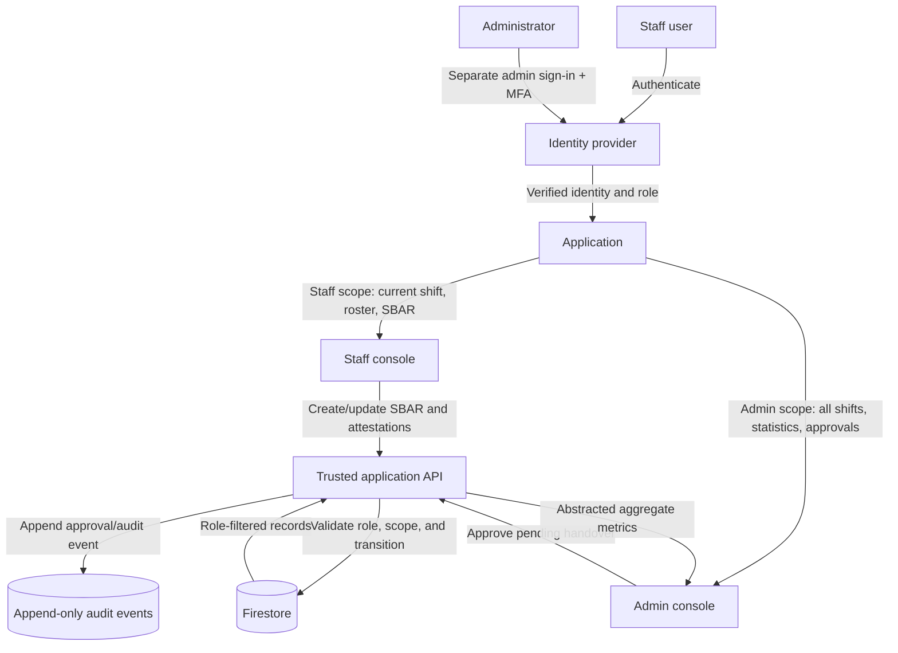
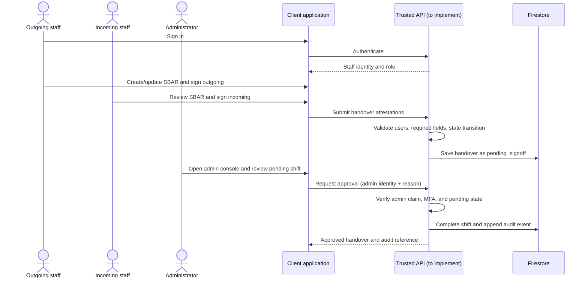
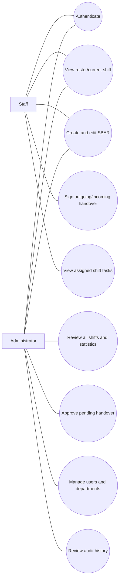
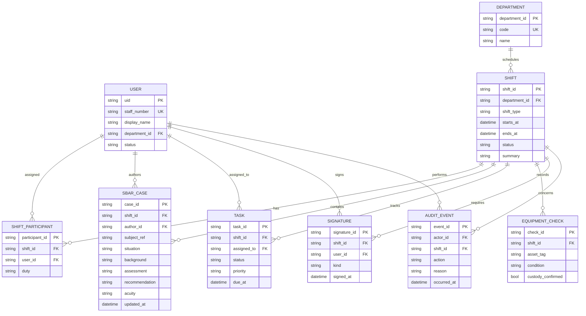

# ZAMU-CHECK system design

## Intended workflow

Staff authenticate, view the operational roster and current shift, record and update SBAR handover cases, and add their outgoing/incoming attestations. A handover with both staff attestations enters `pending_signoff`; only an administrator approves/completes it. The administrator can view system-wide statistics and audit records. Staff do not receive the analytics navigation or analytics view.

## Methodology / data flow

**Implementation note:** the current project is a client-only Vite app. The trusted API, custom role claims, MFA enforcement, and append-only audit service in this target flow do not exist yet. UI hiding and React state checks are usability controls, not authorization controls.

## Sequence: shift handover and approval

## Use cases

## ERD (logical target)

## Firestore collection schema

| Collection | Document key | Core fields / links | Access intent |
|---|---|---|---|
| `users` | Firebase Auth UID | `staffNumber`, `displayName`, `departmentId`, `status`; role belongs in trusted custom claims | User reads own profile; admin manages accounts |
| `departments` | `departmentId` | `code`, `name`, location, capacity | Authenticated staff read relevant department; admin writes |
| `shifts` | `shiftId` | `departmentId`, `shiftType`, dates, `status`, summary, lead IDs | Assigned staff read/update allowed fields; approval server/admin only |
| `shifts/{shiftId}/sbar_cases` | `caseId` | SBAR fields, acuity, author UID, timestamps | Assigned staff read/write while shift is open |
| `shifts/{shiftId}/participants` | UID or participant ID | `userId`, duty, attendance | Assigned staff read; admin manages |
| `shifts/{shiftId}/signatures` | signature ID | `userId`, kind, signed timestamp, attestation text | Create-only for eligible signer; immutable thereafter |
| `tasks` | `taskId` | `shiftId`, `departmentId`, assignee UID, status, due date | Assignee/shift team read and update allowed status fields |
| `incidents` | `incidentId` | department, severity, reporter, status, resolution | Staff report/read scoped records; admin resolves |
| `audit_events` | server-generated ID | actor, action, target, reason, server timestamp | Admin read; trusted server append only |

Store references rather than copying full user profiles, arrays of embedded cases, or credentials into shift documents. Never store PINs, passwords, or admin secrets in Firestore or browser storage. Avoid placing sensitive patient/person data in `subjectRef` unless necessary and access-controlled.

## Security and implementation recommendations

1. **Block deployment until Firestore is secured.** The current [firestore.rules](../firestore.rules) grants public read/write access across operational and user collections. Replace it with authenticated, role- and assignment-scoped rules and test them in the Firebase Emulator.
2. **Move authentication and authorization to Firebase Auth plus trusted server logic.** Admin roles must be provisioned by a trusted environment (custom claims), with MFA and a separate admin sign-in route/application. Never elevate privileges from a client-supplied passkey, profile field, or local storage value. A separate URL alone does not secure the console.
3. **Remove seeded credentials and demo identities before deployment.** `src/data/seedData.ts` currently includes a reusable staff PIN. Do not treat the current local PIN flow or `isAdmin` flag as real authentication.
4. **Enforce state transitions on the server.** Staff attestations should be immutable once submitted; admin approval should require a pending shift, fresh admin authentication, and a mandatory reason. Write the completion and audit event atomically. A client-side guard is bypassable.
5. **Minimize sensitive data and retention.** Keep SBAR content scoped to assigned teams, aggregate analytics for administrators where detailed records are unnecessary, define retention/deletion rules, and log access to sensitive records.
6. **Normalize time and provenance.** Persist server timestamps in UTC, use stable Firebase UIDs for actors, and avoid fabricated hashes or client clocks as evidence of non-repudiation. Use a server-generated event ID and a real signed/hash-chained audit design only if the research requirements call for it.
7. **Separate environments and secrets.** Use distinct Firebase projects for development and production, least-privilege service accounts, environment-managed public Firebase config, and server-only secrets for privileged operations.

## Current implementation boundary

This first pass streamlines the visible staff workflow and adds target design artifacts. It does not claim secure admin isolation: implementing that honestly requires Firebase Auth account provisioning, custom claims/MFA, trusted approval endpoints (for example Cloud Functions), and restrictive Firestore rules as one coordinated backend change. The client-side project currently contains hard-coded demo identity/credential shortcuts, so do not use it with real operational or sensitive records.

## Admin statistics assistant prototype

The admin analytics page sends a question and an aggregated statistics snapshot to `POST /api/admin/statistics`. The browser creates the snapshot from the handover, task, attendance, and sign-off records currently loaded in the app. It contains counts and rates only; names and SBAR text are omitted. Gemini interprets the question and explains the computed figures. It does not create database queries or calculate new figures itself.

The API key must be provided to the Node server as `GEMINI_API_KEY`, using an ignored local `.env` file or the deployment's secret manager. Never prefix it with `VITE_`. `npm run dev` starts the API and Vite together; deployment must build the client and run `npm start` so the server can provide the API route as well as the static client. The default model is `gemini-3.5-flash-lite`; `GEMINI_MODEL` can override it.

The assistant includes a repeatable 5,000-shift synthetic sample for demonstrations and scale-oriented query trials. It is clearly labeled, generated with a fixed seed, held in memory as aggregate counts, and never written into the operational database.

For the academic prototype, use synthetic records only with the free API tier. The assistant uses only the aggregate fields included in its request, and says when a requested metric is not available. Its answers are not an operational decision. The current login is still a client-side demonstration and does not authenticate requests to the Node API; implement verified Firebase identity and admin authorization before exposing the endpoint publicly or using real records.
